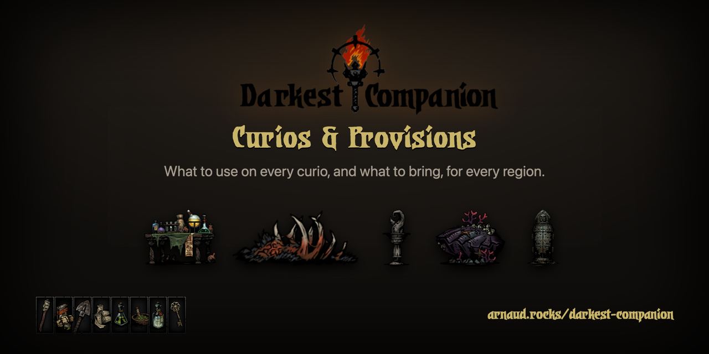

# Darkest Companion

A [Darkest Dungeon](https://www.darkestdungeon.com/) helper: what to use on every curio (with outcome odds), and which provisions to bring for each region and expedition length.

**→ [arnaud.rocks/darkest-companion](https://arnaud.rocks/darkest-companion/)**



- Pick a region and an expedition length: the recommended provisions, region tips and curios update instantly.
- Every curio shows each item you can use on it and the odds of each outcome.
- Your last choice is remembered (saves from the 2016 version carry over).
- Region pages for sharing: [Ruins](https://arnaud.rocks/darkest-companion/ruins/), [Warrens](https://arnaud.rocks/darkest-companion/warrens/), [Weald](https://arnaud.rocks/darkest-companion/weald/), [Cove](https://arnaud.rocks/darkest-companion/cove/).

Data sources and known gaps: [SOURCES.md](SOURCES.md). Found a wrong value? [Open an issue](https://github.com/ArnaudRinquin/darkest-companion/issues) with a link to the source.

Want to build your own? See [RECIPE.md](RECIPE.md).

## Develop

```bash
fnm use            # Node 24 (.nvmrc)
pnpm install
pnpm dev           # http://localhost:4321/darkest-companion/
pnpm test          # data + state unit tests
pnpm build && pnpm preview & pnpm smoke   # browser smoke test (uses local Chrome)
pnpm images        # re-render OG images, favicon, social preview (macOS)
```

Pushing to `master` deploys to GitHub Pages via `.github/workflows/deploy.yml`.

---

Game content, images and materials are trademarks and copyrights of [Red Hook Studios](https://www.redhookgames.com/). Fan-made, not affiliated. Code: MIT.
